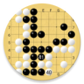

## 
# GoDroid
## Fork of the original [GOdroid](https://sourceforge.net/projects/godroid/) by Andreas Grothe
The game of Go is one of my favorites.  I love being able to just play a game on my phone, but the classic GOdroid, after 12 years, is no longer supported.  So I updated it.

Fixing all of the deprecate API calls, making some edits to and recompiling GnuGo, fixing various odds and ends, and even adding a few new features.  It is now ready for the next decade.  

Major features include:
- Play against a human sitting next to you or GnuGo
- Japanese and Chinese rules
- 9x9, 13x13 and 19x19 boards
- Great touch controls for playing stones
- Save and load SGF's
- Localized to many languages (some translations were made with ChatGPT)

Besides updating API calls, recently added features are:
- Disallowing the AI from resigning
- Delaying the AI by some seconds (I don't like the games feeling frantic)

I am not an Android developer, but I was able to fumble through the updates that were needed.  If anyone has requests for new features, I'll do what I can.  Likewise, if anyone wants to fork this library, go right ahead, but I would also be willing to share this repo with you.

## Contributing
Speak a language this app doesn't yet, or want to fix a translation? See [CONTRIBUTING.md](CONTRIBUTING.md) - no coding required, just a [translation issue](../../issues/new?template=translation.yml).

## License
GoDroid is free software: you can redistribute it and/or modify it under the terms of the GNU General Public License as published by the Free Software Foundation, either version 3 of the License, or (at your option) any later version (see [LICENSE](LICENSE)).

- It is based on [GOdroid](https://sourceforge.net/projects/godroid/) by Andreas Grothe.
- The Go engine is a modified build of [GNU Go](http://www.gnu.org/software/gnugo/) 3.8 (GPL version 3 or later). The unmodified sources are the `third_party/gnugo-3.8` submodule, and the changes are in [patches/gnugo-3.8](patches/gnugo-3.8).

## Artwork credits
The header image (and the launcher icon derived from it) is a detail of *Kibi and the Chinese Minister Playing Go*, an oban print by Kunisada (signing as Toyokuni III), published 1849-53, from the Ishi Press Collection. The original print is in the public domain.
